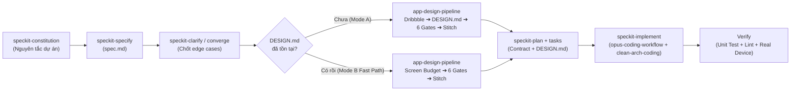
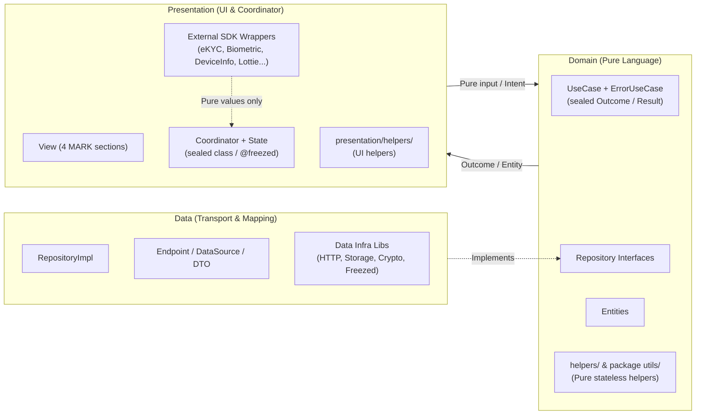
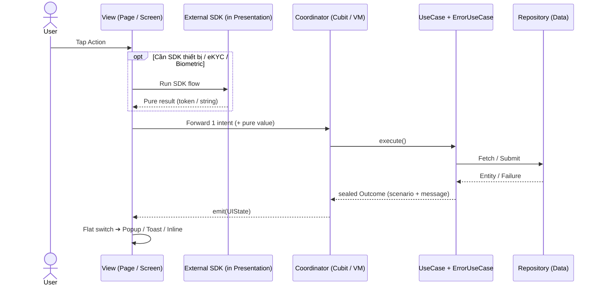
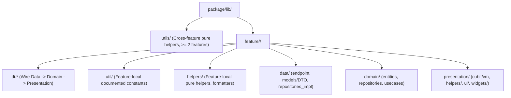
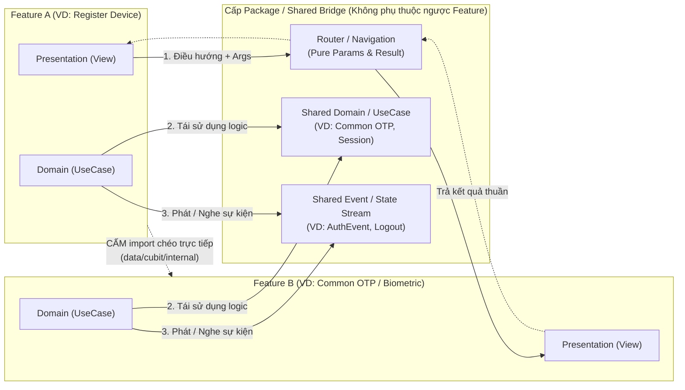

# coding-rules-agent

Bộ **Spec-Driven Development (SDD)**, **App UI/UX Design Pipeline**, **Clean Architecture Coding Standard**, và **Engineering Workflow** cho AI Coding Agent (Antigravity, Codex, Claude Code) trên **Flutter, Android, iOS**.

---

## 0. Quy trình Phát triển Phần mềm End-to-End (Spec → Design → Code → Verify)



- **Spec (`speckit-*`):** Chuẩn hoá yêu cầu thành `spec.md` trước khi thiết kế hay viết code.
- **Design (`app-design-pipeline`):** Chặn UI lộn xộn bằng 6 Quality Gates (`ui-ux-pro-max` + `mobile-design` + `stitch-ui-design`), tạo `DESIGN.md` và render màn hình qua **Stitch MCP** trước khi lập trình.
- **Code (`clean-arch-coding` + `opus-coding-workflow`):** Code từ trong ra ngoài (`Domain -> Data -> DI -> Presentation`), tuân thủ `UseCase <-> Presentation` hard boundary, `Util/` constants, và verify bằng lệnh build/test thật (kích hoạt `hoh-workflow` khi cần phân quyền Planner -> Dev -> QA).

> 📖 **Xem hướng dẫn chi tiết từng bước & giải thích đầy đủ các thành phần tại:** [`docs/WORKFLOW_GUIDE.md`](docs/WORKFLOW_GUIDE.md)

---

## 1. Kiến trúc 3 tầng & Phạm vi phụ thuộc



> **Nguyên tắc cốt lõi:** `Presentation ➔ Domain ⬅ Data`
> - `Domain` thuần ngôn ngữ — không UI framework, không 3rd-party SDK.
> - `Data` chỉ làm transport & map DTO 1-1 — không chứa business rule, không import Feature/Device/UI SDK.
> - **Feature / Device / UI SDK** (`ekyc`, `local_auth`, `device_info_plus`, `camera`, `webview`...) **chỉ import trong `Presentation`** để mỗi feature/plugin tự đóng gói và chạy độc lập.

---

## 2. Luồng xử lý & Phân tách Lỗi (Error / Popup / Toast)



---

## 3. Cấu trúc Feature & Helpers



---

## 4. Giao tiếp & Kết nối giữa các Feature



- **Chuyển màn hình:** Đi qua **Router** bằng tham số/kết quả thuần (không mở trực tiếp `Cubit` hoặc `Data` của feature khác).
- **Dùng chung nghiệp vụ:** Đưa logic/contract dùng chung ra **Shared Domain / UseCase** hoặc `utils/` cấp package (tối đa 2 cấp `Orchestrator -> Atomic`).
- **Giao tiếp bất đồng bộ / tách rời:** Dùng **Event / Stream** dùng chung ở cấp package.

---

## 5. Tóm tắt Quy chuẩn

| Quy tắc | Trọng tâm |
|---|---|
| **3-Layer & DI** | `Presentation ➔ Domain ⬅ Data`, nối qua `di.*`. |
| **Hard Boundary** | Logic chạy được khi bỏ UI ➔ `UseCase`. `Coordinator` chỉ giữ state, gọi 1 `UseCase`, `switch(Outcome)`. |
| **Anti-God-Function** | `execute()` ~25–35 dòng như mục lục; tối đa 2 cấp UseCase (`Orchestrator -> Atomic`). |
| **Control Flow** | Lồng `if/else` tối đa **2 cấp**; ưu tiên guard clause & `switch`. |
| **Single-Class View** | 4 section `// MARK: -`: `Properties & Dependencies`, `Lifecycle`, `UI Rendering`, `UI Handlers & Listeners`. |
| **Exhaustive State** | Immutable & exhaustive `switch`: Dart `sealed class`/`@freezed`, Kotlin `sealed interface`, Swift `enum`. |
| **Single Model** | 1 model ở `domain/entities/` cho case 1-1 (`fromJson` chỉ gọi ở `Data`); tách `DTO` ở `data/` khi lệch schema. |
| **External SDK Scope** | Feature/Device/UI SDK chỉ ở `Presentation`; HTTP/Storage/Serialization lib ở `Data`; `Domain` thuần. |
| **Helpers Purity** | Pure helper ở `helpers/` (local) hoặc `utils/` (shared); UI helper chỉ ở `presentation/helpers/`. |
| **No Magic Constants** | Không fix cứng số/ngưỡng inline; gom `<Feature>Constants` vào `util/` (hoặc `utils/`/`App/Util/`) và ghi doc comment cho hằng số quan trọng. |
| **Plain English** | Đặt tên & commit bằng từ tiếng Anh phổ thông (`get`, `load`, `add`, `fix`, `update`...), tránh từ hiếm/học thuật. |

---

## 6. Cấu trúc Repo

```text
coding-rules-agent/
├── plugin.json                              # Metadata plugin cho Antigravity
├── README.md                                # Tổng quan kiến trúc & hướng dẫn cài đặt
├── docs/
│   └── WORKFLOW_GUIDE.md                    # Hướng dẫn từng bước & giải thích chi tiết các thành phần
├── rules/
│   └── AGENTS.md                            # Luật luôn bật (End-to-End SDD/Design + Clean Arch + English/IPA + HoH)
└── skills/
    ├── # ── Spec-Driven Development (Spec-Kit) ──
    ├── speckit-constitution/                # Khởi tạo / cập nhật constitution.md của dự án
    ├── speckit-specify/                     # Tạo feature spec.md từ mô tả tự nhiên
    ├── speckit-clarify/                     # Làm rõ các điểm mơ hồ trong spec.md
    ├── speckit-converge/                    # Hội tụ & chốt spec trước khi plan
    ├── speckit-plan/                        # Lập implementation plan từ spec.md + DESIGN.md
    ├── speckit-tasks/                       # Chia nhỏ task thực thi
    ├── speckit-analyze/                     # Kiểm tra tính nhất quán spec <-> plan <-> tasks
    ├── speckit-checklist/                   # Sinh checklist kiểm thử/review theo domain
    ├── speckit-implement/                   # Thực thi toàn bộ tasks theo plan
    ├── # ── UI/UX Design Pipeline ──
    ├── app-design-pipeline/                 # Quy trình 6 bước: Spec -> Dribbble -> DESIGN.md -> 6 Gates -> Stitch -> Code
    ├── ui-ux-pro-max/                       # Thư viện style, color palette, typography & UX audit
    ├── mobile-design/                       # Chuẩn thiết kế mobile iOS/Android & touch psychology
    ├── stitch-ui-design/                    # Hướng dẫn viết prompt chuẩn cho Google Stitch MCP
    ├── motion-design/                       # Nguyên lý animation, timing, easing & micro-interactions (LottieFiles)
    ├── # ── Coding & Engineering Workflow ──
    ├── clean-arch-coding/                   # Template & adapter Flutter / Android / iOS
    ├── opus-coding-workflow/                # Quy trình Spec-first, Refactor, Debug, Verify
    ├── hoh-workflow/                        # Quy trình phân quyền 3 vai trò Planner -> Dev -> QA
    └── english-grammar-mentor/              # Sửa tiếng Anh & IPA viết hoa trọng âm
```

- `rules/AGENTS.md` (Always-on): Nguyên tắc bất biến, luôn nạp vào context.
- `skills/` (On-demand): Template chi tiết & checklist, chỉ đọc khi đúng tác vụ.
- **Lưu ý tích hợp:** Các skill `speckit-*` sử dụng thư mục `.specify/` trong project (cài qua `specify init --ai agy` hoặc copy `.specify/`), còn `app-design-pipeline` dùng **Stitch MCP** khi sinh màn hình.

---

## 7. Cài đặt & Tích hợp

### A. Antigravity
- **Global Plugin:**
  ```bash
  git clone https://github.com/doducthanh95/coding-rules-agent.git ~/.gemini/config/plugins/coding-rules-agent
  # Cập nhật: git -C ~/.gemini/config/plugins/coding-rules-agent pull
  ```
- **Per-Project (`.agents/`):**
  ```bash
  mkdir -p .agents && cp -r /path/to/coding-rules-agent/{rules,skills} .agents/
  ```

### B. OpenAI Codex
- **Global (`~/.codex/`):**
  ```bash
  git clone https://github.com/doducthanh95/coding-rules-agent.git ~/coding-rules-agent
  mkdir -p ~/.codex/skills
  ln -sf ~/coding-rules-agent/rules/AGENTS.md ~/.codex/AGENTS.md
  ln -sf ~/coding-rules-agent/skills/* ~/.codex/skills/
  ```
- **Per-Project:**
  ```bash
  cp ~/coding-rules-agent/rules/AGENTS.md ./AGENTS.md
  mkdir -p .agents/skills && cp -r ~/coding-rules-agent/skills/* .agents/skills/
  ```

### C. Claude Code (`claude`)
- **Global (`~/.claude/`):**
  ```bash
  git clone https://github.com/doducthanh95/coding-rules-agent.git ~/coding-rules-agent
  mkdir -p ~/.claude/skills
  ln -sf ~/coding-rules-agent/rules/AGENTS.md ~/.claude/CLAUDE.md
  ln -sf ~/coding-rules-agent/skills/* ~/.claude/skills/
  ```
  *(Nếu đã có `~/.claude/CLAUDE.md`, hãy nối thêm nội dung thay vì ghi đè.)*
- **Per-Project:**
  ```bash
  cp ~/coding-rules-agent/rules/AGENTS.md ./CLAUDE.md
  mkdir -p .claude/skills && cp -r ~/coding-rules-agent/skills/* .claude/skills/
  ```
