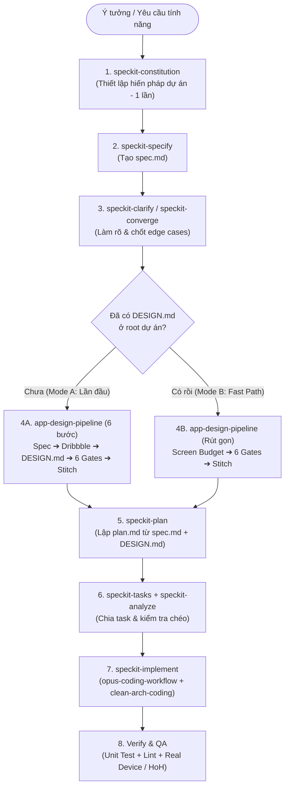

# Hướng dẫn chi tiết Quy trình Phát triển Phần mềm (Spec → Design → Code → Verify)

Tài liệu này giải thích **từng bước sử dụng**, **vai trò của từng thành phần/skill**, và **ví dụ prompt thực tế** để vận hành trọn vẹn quy trình từ lúc có ý tưởng đến khi ra code sạch và được kiểm chứng.

---

## 1. Tổng quan Luồng Hoạt động (End-to-End Flow)



### Bảng tóm tắt Đầu vào – Công cụ – Đầu ra theo từng giai đoạn

| Giai đoạn | Skill / Rule tham gia | Đầu vào (Input) | Đầu ra (Artifact) | Cổng kiểm soát (Gate) |
|---|---|---|---|---|
| **1. Spec** | `speckit-constitution`, `speckit-specify`, `speckit-clarify`, `speckit-converge`, `speckit-checklist` | Mô tả ý tưởng tự nhiên | `.specify/memory/constitution.md`, `specs/<feature>/spec.md` | Spec không còn `[NEEDS CLARIFICATION]`, chốt edge cases |
| **2. Design** | `app-design-pipeline`, `ui-ux-pro-max`, `mobile-design`, `stitch-ui-design`, `motion-design` | `spec.md` (hoặc `UI_SPEC_REQUIREMENTS.md`) | `DESIGN.md` (root + Motion Identity), Stitch Project + PNG screens đã duyệt | Đạt đủ **6 Design Quality Gates**, không cắt chữ (`...`), đúng layout Dribbble |
| **3. Plan** | `speckit-plan`, `speckit-tasks`, `speckit-analyze` | `spec.md` + `DESIGN.md` + `constitution.md` | `plan.md`, `tasks.md`, `contracts/` | Nhất quán 100% giữa Spec, Design và Clean Architecture |
| **4. Code** | `rules/AGENTS.md`, `opus-coding-workflow`, `clean-arch-coding`, `hoh-workflow` | `plan.md`, `tasks.md`, Stitch screens | Code theo 3 tầng (`Domain -> Data -> DI -> Presentation`) + `Util/` constants | Không rò rỉ logic vào UI, không DTO 1-1, không magic number |
| **5. Verify** | `opus-coding-workflow` (hoặc `hoh-workflow` QA) | Code + Unit Tests | Log `flutter test` / `xcodebuild` / `./gradlew` exit code `0` | Pass 100% build, lint, headless `UseCase` test & real device |

---

## 2. Giải thích từng Thành phần trong Bộ Rules & Skills

### A. Nhóm Luật Luôn Bật (`rules/AGENTS.md`)
Đây là file được AI Agent nạp tự động vào context ở **mọi phiên làm việc**, đóng vai trò là "hàng rào cứng":
1. **End-to-End Lifecycle:** Định tuyến Agent đi đúng thứ tự `Spec → Design → Plan → Code → Verify`, tránh nhảy cóc vào viết code khi chưa có spec hoặc design.
2. **7 Core Invariants (Clean Architecture):**
   - **3-Layer & DI:** `Presentation -> Domain <- Data` + `DI`. `Domain` thuần ngôn ngữ; `Data` chỉ làm transport & map.
   - **Hard Boundary (`UseCase` vs `Presentation`):** Mọi logic vẫn phải chạy được nếu xóa UI (validation, business rule, eligibility, error mapping) nằm ở `UseCase`. `Coordinator/ViewModel` chỉ giữ state và switch `Outcome`.
   - **Control Flow:** Lồng `if/else` tối đa **2 cấp**, ưu tiên guard clause và `switch` vét cạn.
   - **Pragmatic Single Model:** Mặc định dùng **1 model** ở `domain/entities/`. **Cấm** tạo `DTO` 1-1 ở `data/models/`; chỉ tách `DTO` khi JSON API lồng sâu hoặc gộp nhiều endpoint.
   - **Plain & Common English:** Đặt tên file/hàm/commit bằng từ tiếng Anh phổ thông (`get`, `load`, `save`, `add`, `fix`...).
   - **Tiered Feature Scope:** Phân tầng linh hoạt theo độ phức tạp (Full Feature / Logic-SDK Feature / Pure UI Screen).
   - **No Hardcoded Magic Constants (`Util/`):** Không viết cứng ngưỡng, timeout, budget, hệ số thuật toán inline; gom vào `<Feature>Constants` trong `Util/` (`util/`) kèm doc comment giải thích ý nghĩa, đơn vị và tác động.
3. **English Grammar & IPA Review:** Tự động sửa ngắn gọn câu tiếng Anh của bạn và kèm phiên âm IPA có **VIẾT HOA âm tiết trọng âm**.
4. **HoH Trigger (`hoh-workflow`):** Chỉ kích hoạt quy trình 3 vai trò độc lập (`Planner` → `Dev` → `QA`) khi bạn nhắc từ khóa **`HoH` / `Harness of Harness`**.

---

### B. Nhóm Spec-Driven Development (`speckit-*`)
Các skill này dựa trên GitHub **Spec-Kit** (yêu cầu project đã khởi tạo thư mục `.specify/` qua `specify init --ai agy` hoặc copy `.specify/`):
- **`speckit-constitution`**: Tạo/cập nhật "hiến pháp" dự án (`.specify/memory/constitution.md`) gồm nguyên tắc kiến trúc, giới hạn hiệu năng/bộ nhớ (VD: target iPhone 4GB RAM), tech stack bắt buộc.
- **`speckit-specify`**: Chuyển mô tả tính năng thành `spec.md` chuẩn mực (User Stories, Acceptance Criteria, Edge Cases, Functional Requirements).
- **`speckit-clarify`**: Rà soát `spec.md` để hỏi lại tối đa các điểm còn mơ hồ (auth, offline, error state, giới hạn dữ liệu) và ghi thẳng câu trả lời vào `spec.md`.
- **`speckit-converge`**: Hội tụ các phương án còn phân vân trong spec thành 1 quyết định chốt duy nhất trước khi sang bước thiết kế.
- **`speckit-checklist`**: Sinh bộ checklist kiểm tra chất lượng theo từng domain (UX, Security, Performance, Accessibility).
- **`speckit-plan`**: Kết hợp `spec.md` + `DESIGN.md` + `constitution.md` để lập bản thiết kế kỹ thuật (`plan.md`), cấu trúc thư mục, contracts và model.
- **`speckit-tasks`**: Tách `plan.md` thành danh sách task nguyên tử (`tasks.md`), đánh dấu `[P]` cho các task chạy song song được.
- **`speckit-analyze`**: Kiểm tra chéo không sửa file để phát hiện mâu thuẫn giữa `spec.md`, `plan.md` và `tasks.md` trước khi code.
- **`speckit-implement`**: Thực thi lần lượt từng task trong `tasks.md` cho đến khi hoàn thành và vượt qua verify.

---

### C. Nhóm UI/UX Design Pipeline (`app-design-pipeline` + 3 Design Skills)
- **`app-design-pipeline` (Nhạc trưởng thiết kế):** Quy trình 6 bước biến `spec.md` thành UI hiện đại, zero-clutter trước khi viết code UI:
  - **Mode A (Dự án mới / chưa có `DESIGN.md`):** Chạy đủ 6 bước (Screen Budget → Tìm & chọn Dribbble Reference → Trích xuất `DESIGN.md` → Áp dụng 6 Quality Gates → Sinh màn hình trên Stitch MCP → Bàn giao code).
  - **Mode B (Tính năng mới / đã có `DESIGN.md`):** Nhảy qua bước Dribbble & tạo `DESIGN.md`, dùng thẳng `stitch_project_id` và `stitch_design_system` đã khóa để sinh màn hình mới nhất quán 100%.
- **`ui-ux-pro-max`:** Cung cấp thư viện tra cứu style, bảng màu, font pairing, UX guidelines và stack hints (`swiftui`, `flutter`, `react-native`...).
- **`mobile-design`:** Bộ chuẩn thiết kế riêng cho iOS/Android (touch target `>= 44×44pt`, thumb zone, bottom sheet vs modal, native tab bar).
- **`stitch-ui-design`:** Kỹ thuật viết prompt chuẩn xác cho **Google Stitch MCP** (`generate_screen_from_text`, `edit_screens`, `create_design_system`).
- **`motion-design` (Animation & Micro-interactions):** Chuẩn hoá chuyển động UI theo 3 trụ cột (*Emotional Intent, Visual Narrative, Motion Craft*), chọn **Motion Personality** (`Playful`, `Premium`, `Corporate`, `Energetic`), bộ duration/easing và quy tắc 1/3. Dùng ở **Bước 3 của `app-design-pipeline`** (ghi Motion Identity vào `DESIGN.md`) và **Bước 6 / `speckit-implement`** (code animation SwiftUI, Flutter, CSS/GSAP/Lottie).

---

### D. Nhóm Coding & Engineering Workflow
- **`opus-coding-workflow`:** Quy trình kỹ sư thực chiến: *Inventory (đọc code liên quan trước) → Preview/Contract Gate (chốt phương án khi thay đổi lớn) → Implement (fix tận gốc, không vá tạm) → Verify (chạy lệnh build/test thật)*. Có sẵn tài liệu bẫy kỹ thuật cho iOS Xcode/Networking, Flutter, macOS SwiftUI.
- **`clean-arch-coding`:** Bộ template & quy chuẩn chi tiết cho từng nền tảng (`references/flutter.md`, `references/android.md`, `references/ios.md`). Agent **chỉ đọc đúng 1 file** khớp với nền tảng dự án đang làm để tránh lẫn thuật ngữ.
- **`hoh-workflow`:** Quy trình tách 3 vai trò độc lập (**Planner** chỉ đọc → **Dev** chỉ code đúng micro-sprint → **QA** chỉ chạy lệnh kiểm thử thật, Zero Trust) cho các tác vụ phức tạp hoặc dễ gây regression.

---

## 3. Hướng dẫn từng bước thực hành (Step-by-Step Playbook)

### Bước 0: Khởi tạo cho dự án mới (Làm 1 lần)
1. Cài đặt plugin `coding-rules-agent` (xem mục Cài đặt ở `README.md`).
2. Khởi tạo Spec-Kit trong project (nếu chưa có `.specify/`):
   ```bash
   specify init --here --ai agy
   ```
3. Thiết lập Hiến pháp dự án với `speckit-constitution`:
   > **Prompt mẫu:** *"Dùng `speckit-constitution` tạo constitution cho app iOS/Flutter này: ưu tiên Clean Architecture 3 tầng, offline-first, giới hạn RAM, và luôn verify bằng unit test + build thật."*

---

### Bước 1: Viết & Chốt Spec (`speckit-specify` → `clarify` / `converge`)
1. Mô tả tính năng bằng ngôn ngữ tự nhiên:
   > **Prompt mẫu:** *"Dùng `speckit-specify` viết spec cho tính năng Luyện phát âm từ vựng theo chủ đề: có danh sách chủ đề, màn hình luyện đọc từng từ có chấm điểm IPA, và lưu lịch sử tiến độ."*
2. Nếu còn điểm chưa rõ (VD: xử lý offline, giới hạn số từ/lần, cơ chế retry), chạy tiếp:
   > **Prompt mẫu:** *"Chạy `speckit-clarify` (hoặc `speckit-converge`) để chốt hết các edge case của spec vừa tạo."*

---

### Bước 2: Thiết kế UI/UX & Sinh màn hình Stitch (`app-design-pipeline`)
Sau khi chốt `spec.md`, chạy thiết kế **trước khi lập `plan.md` và viết code**:
> **Prompt mẫu:** *"Dùng `app-design-pipeline` thiết kế UI từ `spec.md` vừa tạo."*

Agent sẽ tự kiểm tra root dự án:
- **Nếu chưa có `DESIGN.md` (Mode A):**
  1. Agent rút gọn `spec.md` thành **Screen Budget** (phân tách Tab chính vs Modal room, 1 Hero block mỗi màn).
  2. Agent tìm 3–5 link Dribbble phù hợp và **dừng lại chờ bạn chọn 1 mẫu ưng ý**.
  3. Agent đọc ảnh/video mẫu bạn chọn → tạo `DESIGN.md` ở root (chứa Visual Tokens + Layout Architecture).
  4. Agent áp dụng **6 Design Quality Gates** (cấm giữ khung card cũ chỉ đổi màu, title `<= 4` từ, nút 1 dòng không `...`, tab bar tối đa 4–5 mục, touch `>= 44pt`).
  5. Agent gọi **Stitch MCP** tạo Design System & sinh từng màn hình, tải PNG về và tự soi lại bằng mắt trước khi trình bạn duyệt.
- **Nếu đã có `DESIGN.md` (Mode B Fast Path):**
  - Agent bỏ qua bước tìm Dribbble & tạo `DESIGN.md`, dùng luôn `stitch_project_id` và `stitch_design_system` đã khóa để sinh màn hình mới cho tính năng này.

---

### Bước 3: Lập Plan, Chia Tasks & Kiểm tra chéo (`speckit-plan` → `tasks` → `analyze`)
Khi màn hình Stitch và `DESIGN.md` đã được duyệt:
1. Lập kế hoạch kỹ thuật kết hợp Spec + Design + Clean Architecture:
   > **Prompt mẫu:** *"Dùng `speckit-plan` lập implementation plan dựa trên `spec.md`, `DESIGN.md` và chuẩn `clean-arch-coding` cho nền tảng hiện tại."*
2. Chia nhỏ thành các task có thể thực thi độc lập:
   > **Prompt mẫu:** *"Chạy `speckit-tasks` để sinh `tasks.md`, sau đó chạy `speckit-analyze` kiểm tra chéo xem có lệch giữa spec, design và plan không."*

---

### Bước 4: Triển khai Code (`speckit-implement` + `clean-arch-coding` + `opus-coding-workflow`)
Bắt đầu code theo đúng thứ tự từ trong ra ngoài (`Domain` → `Data` → `DI` → `Presentation`):
> **Prompt mẫu:** *"Chạy `speckit-implement` thực thi `tasks.md` theo đúng `clean-arch-coding` và `opus-coding-workflow`. Lưu ý tách hằng số vào `Util/` có doc comment và viết headless unit test cho `UseCase`."*

*(Nếu tính năng lớn, nhiều file nhạy cảm hoặc cần kiểm soát regression chặt chẽ, thêm từ khóa **`HoH`** vào prompt để kích hoạt phân quyền `Planner -> Dev -> QA`.)*

---

### Bước 5: Kiểm chứng thực tế (Verification)
Agent chỉ được phép báo hoàn thành khi đã chạy thật và có log exit code `0`:
- **Flutter:** `flutter analyze && flutter test`
- **iOS:** `xcodebuild test ...` (kèm kiểm tra trên thiết bị thật nếu liên quan Audio/Camera/ML)
- **Android:** `./gradlew testDebugUnitTest lint`

---

## 4. Các lỗi thường gặp & Cách phòng tránh trong Flow

| Vấn đề | Nguyên nhân thường gặp | Cơ chế chặn trong bộ Rules/Skills |
|---|---|---|
| UI rối, nhiều chữ, nút bị cắt `...` | Đẩy thẳng spec dài vào prompt UI | `app-design-pipeline` (Screen Budget + 6 Quality Gates) |
| Thêm feature mới bị lệch màu/font với app cũ | Quên dùng lại token cũ khi prompt UI | `app-design-pipeline` **Mode B Fast Path** (đọc `DESIGN.md` & khóa `stitch_design_system`) |
| Đẻ thêm `DTO` giống hệt `Entity` | Tạo máy móc `UserDto` + `UserEntity` cho mọi API | `rules/AGENTS.md` Rule #4 (**Pragmatic Single Model**) |
| Logic nghiệp vụ tràn vào `View` / `ViewModel` | Viết `if/else` check điều kiện, parse HTTP code ở UI | `rules/AGENTS.md` Rule #2 (**Hard Boundary & Headless Test**) |
| Fix bug kiểu chắp vá, sinh bug mới | Nhảy vào sửa file khi chưa đọc hết call-site | `opus-coding-workflow` (**Inventory First & Root-Cause Fix**) |
| Số cấu hình/ngưỡng bị rải rác khắp code | Hardcode `0.75`, `3000`, `4096` inline trong logic | `rules/AGENTS.md` Rule #7 (**No Hardcoded Magic Constants `Util/`**) |
