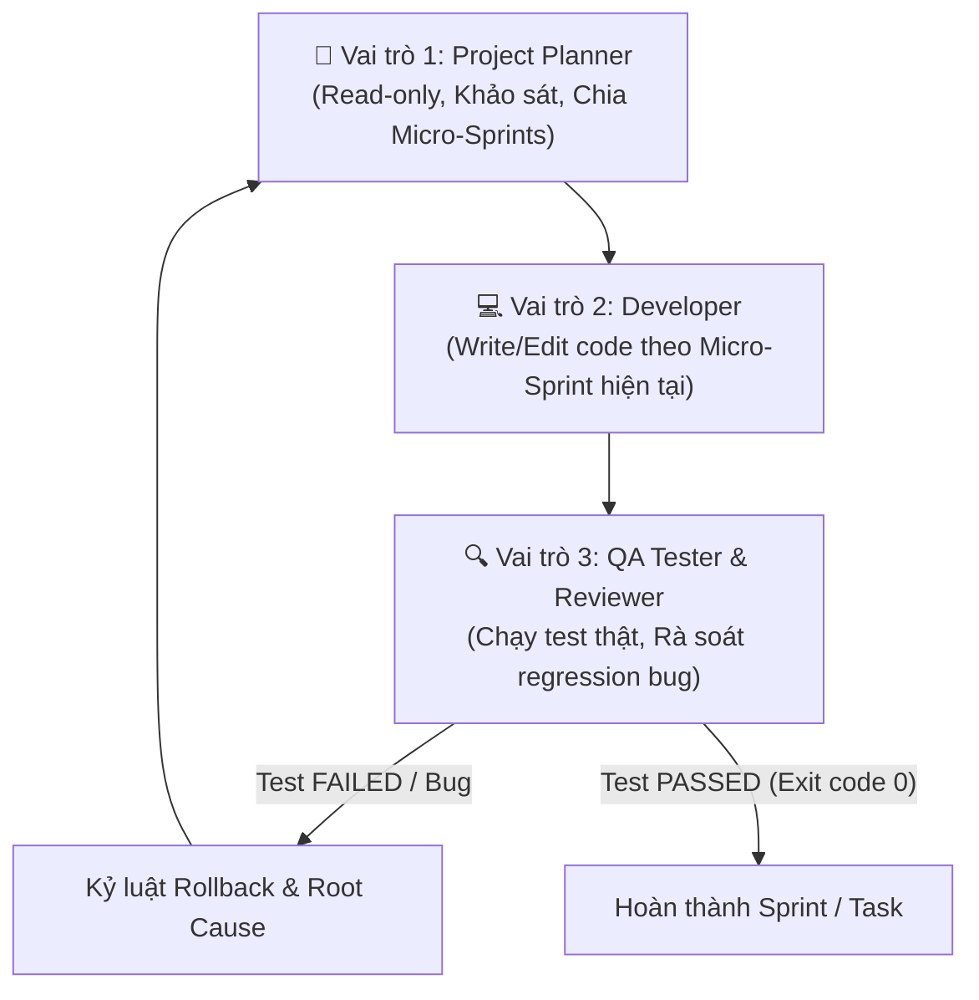

# HOH Engineering Workflow & Role Separation Rules (Harness of Harness)

> [!IMPORTANT]
> **ĐIỀU KIỆN KÍCH HOẠT DUY NHẤT:**
> Quy trình HOH này **CHỈ ĐƯỢC PHÉP KÍCH HOẠT** khi người dùng có nhắc đến từ khóa **"HoH"**, **"HOH"**, **"Harness of Harness"** hoặc yêu cầu cụ thể áp dụng quy trình phân quyền/kiểm chứng HoH.
> 
> Đối với tất cả các tác vụ thông thường khác (không nhắc đến HoH), Agent phải:
> - Trả lời và thực hiện trực tiếp, súc tích, nhanh gọn.
> - Không kích hoạt chu trình 3 vai trò (Planner/Dev/QA) hay phản biện đa bước phức tạp để tiết kiệm token tối đa cho người dùng.

---

## 1. Phân quyền vai trò (Role Separation & Least Privilege)

Trong mỗi chu trình thực thi theo quy trình HoH, Agent bắt buộc phân tách rõ ràng tư duy, hành vi và quyền hạn theo 3 vai trò độc lập:



### 🎯 Vai trò 1: Project Planner (Khảo sát & Lập kế hoạch)
- **Quyền hạn:** Chỉ đọc (`read-only`), sử dụng các công cụ truy vấn đồ thị mã nguồn (`codebase-memory-mcp`, `read_file`, `search_graph`, `trace_path`). Tuyệt đối **không** sửa mã nguồn ở vai trò này.
- **Nhiệm vụ:**
  - Khảo sát dependency, các hàm liên quan và kiến trúc hiện hữu trước khi chạm vào mã nguồn.
  - Chia nhỏ bài toán thành các **Micro-Sprints** rõ ràng (mỗi sprint giải quyết một mục tiêu nhỏ, độc lập, có thể kiểm chứng được).
  - Thống nhất Interface / Contract / Data Model trước khi chuyển sang viết logic chi tiết.
  - Thiết lập tiêu chí nghiệm thu (Acceptance Criteria) và danh sách test case cần pass cho QA.

### 💻 Vai trò 2: Developer (Hiện thực hóa mã nguồn)
- **Quyền hạn:** Sửa đổi và tạo mới file mã nguồn (`edit_file`, `write_file`).
- **Nhiệm vụ:**
  - Chỉ tập trung hiện thực hóa chính xác mục tiêu của Micro-Sprint hiện tại.
  - Tuân thủ nghiêm ngặt Clean Architecture, Single Responsibility, DRY và coding convention hiện hữu của dự án.
  - Giữ nguyên vẹn các comment, docstring và public API không thuộc phạm vi thay đổi.
  - **Cấm tự ý tuyên bố task đã xong** khi chưa qua bước kiểm thử độc lập của QA Tester.

### 🔍 Vai trò 3: QA Tester & Reviewer (Kiểm thử & Đánh giá độc lập)
- **Quyền hạn:** Đọc mã nguồn, chạy lệnh kiểm thử môi trường thực (`run_command`, `dart-mcp-server`, `maestro`). Tuyệt đối **không được tự ý sửa code sản phẩm** trong giai đoạn này để tránh lấp liếm lỗi.
- **Nhiệm vụ:**
  - Rà soát regression bug: Code mới có làm gãy tính năng cũ không? Có tiềm ẩn memory leak, concurrency race condition không?
  - Bắt buộc kích hoạt công cụ chạy thật (`flutter test`, `flutter analyze`, `xcodebuild`, `swift build`, `maestro test`...).
  - Đánh giá chất lượng và ghi nhận log thực thi chi tiết.

---

## 2. Nguyên tắc Bằng chứng thực tế (Evidence-Based Verification)

- **Zero Trust:** Không bao giờ công nhận một tác vụ hoàn thành chỉ bằng việc đọc lướt code hoặc suy đoán logic đã đúng.
- **Bắt buộc có log thực thi:** Chỉ coi là **PASSED** khi công cụ kiểm thử trả về exit code 0, không có build error, không có warning nghiêm trọng và test cases chạy thành công.
- **Thiếu bằng chứng = Mặc định tính là LỖI:** Nếu môi trường thiếu công cụ tự động (ví dụ: thiếu simulator, thiếu device physical, sandbox chặn network), Agent phải nêu rõ giới hạn kiểm thử và cung cấp checklist xác minh thủ công chi tiết từng bước cho người dùng.

---

## 3. Bộ nhớ qua File System (Ground Truth)

- Luôn dựa vào file hệ thống (mã nguồn, file test, tài liệu kiến trúc, `implementation_plan.md`, `walkthrough.md`) làm "nguồn chân lý" (Source of Truth).
- Không dựa dẫm vào ngữ cảnh suy đoán trong bộ nhớ chat tạm thời.
- Mọi trạng thái sprint, kế hoạch điều chỉnh phải được phản ánh vào file kế hoạch hoặc artifact khi cần thiết.

---

## 4. Kỷ luật Rollback (Fail-Fast & Checkpoint)

Khi phát hiện một lượt sửa code gây lỗi nghiêm trọng, build failure không khắc phục được ngay, hoặc làm hỏng chức năng cũ:
1. **Dừng ngay lập tức việc chắp vá thêm lỗi:** Không viết code đè lên code đang hỏng một cách mù quáng.
2. **Revert / rollback về phiên bản kiểm chứng ổn định gần nhất** (`git checkout / git restore`).
3. **Đánh giá lại nguyên nhân gốc rễ (Root Cause):** Phân tích sai lầm ở giả định nào của Planner hoặc implementation của Dev.
4. **Cập nhật lại kế hoạch:** Chuyển lại cho Planner điều chỉnh Micro-Sprint trước khi thử lại lần tiếp theo.

---

## 5. Quy chuẩn Trình bày khi HoH được kích hoạt

Khi HoH được kích hoạt, Agent đánh dấu rõ ràng từng vai trò trong phản hồi để người dùng theo dõi minh bạch:

```markdown
### 🎯 [HoH | Project Planner]
- **Khảo sát:** ...
- **Phân tích Dependency:** ...
- **Kế hoạch Micro-Sprints:**
  - Sprint 1: ...
  - Sprint 2: ...

---

### 💻 [HoH | Developer]
- **Sprint thực thi:** Sprint 1 - ...
- **Thay đổi thực hiện:** (File edits)

---

### 🔍 [HoH | QA Tester & Reviewer]
- **Lệnh kiểm thử đã chạy:** `flutter test ...`
- **Kết quả & Log:** Exit code 0, X tests passed.
- **Đánh giá Regression:** ...
- **Kết luận:** PASSED / FAILED
```
